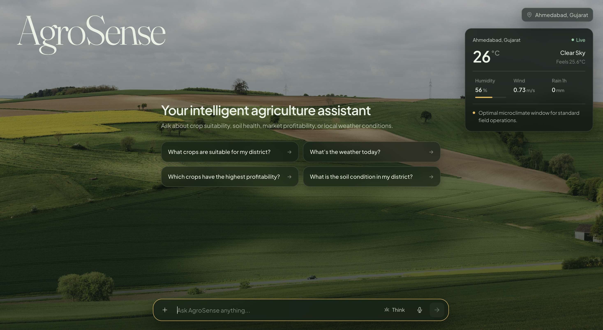
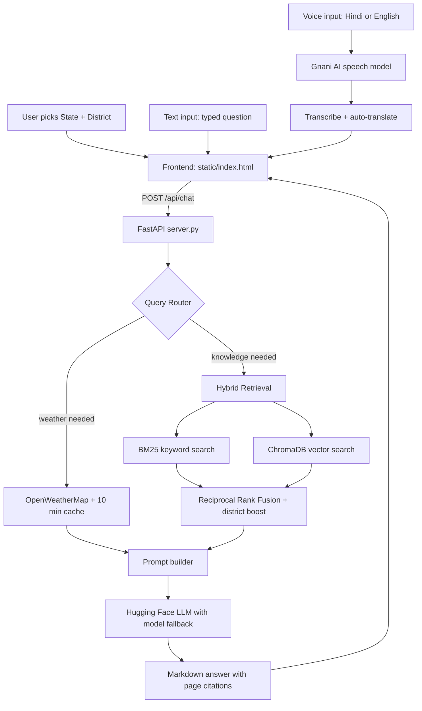

<h1 align="center">AgroSense</h1>

A farming assistant I built that gives advice based on your state and district, using live weather and a knowledge base made from an agriculture PDF.



## Why I made this

General chatbots give generic farming advice. An LLM doesn't actually have district-level numbers like soil nitrogen percentage or the last two years of crop yields, so it ends up guessing. For farming, a guess isn't good enough.

So I built the knowledge base myself. The PDF this project searches was made by cleaning and combining 4 different messy datasets into one structured document, with the exact figures for each district. When you ask a question, AgroSense:

- looks up your district's real data from that PDF (soil, crops, past yields, seasons, irrigation)
- adds the current weather for your location
- lets the LLM explain it in plain language, with page numbers so you can check every claim

The numbers come from the data, not from the model's memory. That's what makes the answers reliable and something you can trust.

## What it does

- **Asks for your location first.** A popup takes your state and district (all 36 states/UTs, searchable). You can change it any time without restarting.
- **Hybrid search.** Questions are searched with both BM25 (keywords) and ChromaDB (vectors), and the results are merged with Reciprocal Rank Fusion. Chunks that mention your district get a small boost.
- **Query router.** A simple keyword check decides whether a question needs weather, document search, both, or neither. This saves API calls. It also understands some Hinglish words like *barish*, *fasal* and *sinchai*.
- **Speak in Hindi or English.** Farmers can ask questions by voice instead of typing. Hindi speech is transcribed using a Gnani AI speech model and automatically translated, so you can just talk in Hindi without switching languages. Answers are shown as text.
- **Conversation memory.** The last 5 messages are sent to the model as they are. Anything older than that is squashed into a short running summary, so it can still follow up on earlier questions without the prompt getting longer each time.
- **Live weather** from OpenWeatherMap, cached for 10 minutes.
- **LLM fallback.** It uses the Hugging Face Inference API and tries another model if one fails or returns nothing.
- **Careful prompt.** The model is told not to make up prices, dosages, scheme eligibility or sources, and to cite pages.
- **Frontend.** Chat-style page with Markdown rendering, voice input, a "Think" mode for longer answers, and starter questions.
- **Errors.** Missing keys or failed API calls show a readable message instead of a traceback.

## How it works



The frontend sends `{query, state, district, think}` to the backend. The backend routes the question, collects weather and/or document context, adds the chat memory (the summary plus the last 5 messages), builds the prompt, calls the LLM and returns the answer.

## Built with

- Python, FastAPI, Uvicorn
- LangChain (loaders and splitters), ChromaDB, rank-bm25
- sentence-transformers `all-MiniLM-L6-v2` for embeddings
- Hugging Face Inference API (Llama 3.1, Qwen 2.5, gpt-oss)
- OpenWeatherMap API
- Gnani AI speech model for Hindi voice input
- Plain HTML/CSS/JS on the frontend, with `marked` and `DOMPurify` for Markdown

## Files

```
AgroSense/
├── main.py         # router, weather, hybrid retrieval, LLM calls
├── server.py       # FastAPI app for the web UI
├── locations.py    # states and districts for the popup
├── Main_Backup.py  # old backup of main.py
├── static/         # index.html (whole frontend) and background image
├── docs/           # screenshot
└── India_District_Agri_Master_RAG.pdf   # the knowledge base
```

## Running it

1. Clone and install:

```
git clone https://github.com/Kxbir31/AgroSense.git
cd AgroSense
python -m venv .venv
source .venv/bin/activate        # Windows: .venv\Scripts\activate
pip install -r requirements.txt
```

2. Make a `.env` file in the project root:

```
HF_TOKEN=your_huggingface_token
OPENWEATHER_API_KEY=your_openweathermap_key
```

You can get a Hugging Face token at https://huggingface.co/settings/tokens (turn on Inference Providers) and a weather key at https://openweathermap.org/api.

3. Start the server:

```
uvicorn server:app --host 127.0.0.1 --port 8000
```

Then open http://127.0.0.1:8000.

The first run builds the vector database from the PDF, which takes a minute or two. After that it reuses it. If you change the PDF, delete the `chroma_db/` folder so it gets rebuilt.

## Things you can ask

- What crops are suitable for my district?
- Should I spray pesticide today? (uses weather + district data)
- What is the soil like in my district?
- Kal barish hogi kya, sinchai karni chahiye?

## Notes on keys and safety

API keys stay in `.env` and are never sent to the browser. Input is checked on the server and the model's output is sanitized before it's shown. `.env` and `chroma_db/` are in `.gitignore`.

## Author

Kabir Bhardwaj, [@Kxbir31](https://github.com/Kxbir31)
